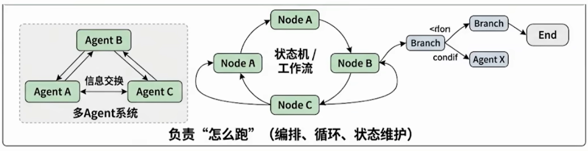
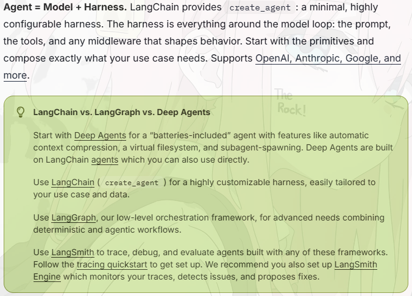
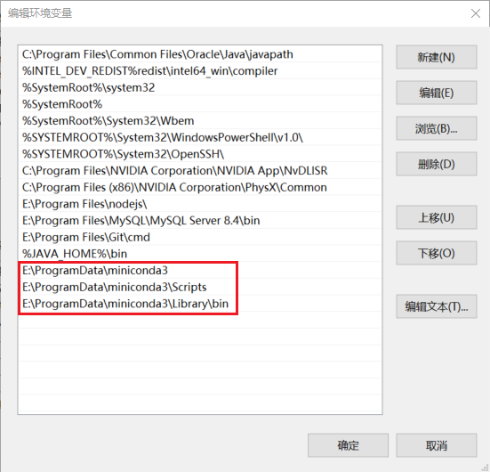

---
tags:
  - knowledge
introduction: 大模型应用开发
start_date: 2026-10-15
---

# 1 LangChain 1.2 概述  

## 1_1 单一的大语言模型的局限性  
1. 知识受限于训练数据。（大语言模型其实不能获取网络信息的）
2. 无法直接与外部系统交互。（无法查找实时数据，调用 API 或调取数据库）
3. 不具备状态保持能力。（难以进行连贯的多轮对话，遗忘之前的上下文）

## 1-2 LangChain 框架的定位  

> LangChain 作为大模型与应用间的中间层，可统一调用各类大模型、管理提示词与上下文，还能集成外部工具和数据源，快速搭建具备推理、行动能力的智能体。  

核心定位三点：  
1. 打通大模型与外部资源：统一接口对接数据库、检索引擎、API、文件系统等。
2. 封装底层复杂逻辑：抽象工具调用、记忆等功能，降低智能体开发难度。
3. 支撑多智能体协作：依托 LangGraph 等生态，从单智能体拓展至多智能体协作，可构建工业级智能体。

# 2 LangChain 
 
## 2-1 LangChain v 1.2 的主要模块  
- `langchain-core`：官方推荐的核心 API。
- `langchain-classic`：冗余代码或不推荐使用的经典 API 都移到此。
- `langchain-community`：第三方集成。
- `langgraph`：深度整合 LangGraph 1.0,协调多个 Chain，Agent，Tools 完成更复杂的任务，并且支持循环调用，是 langchain 图形化的增强版。

## 2-2 API 文档
[官网](https://reference.langchain.com/)  
[Github](https://github.com/langchain-ai)
[英文文档](https://docs.langchain.com/oss/python/deepagents/overview)
[中文文档](https://langchain-zh.cn/oss/python/langchain/overview)
[API 文档](https://reference.langchain.com/python/langchain/overview)

# 3 LangChain 生态四大支柱  

LangChain 技术生态的四大核心支柱构成：`LangChain`，`LangGraph`，`Deep Agent`，`LangSmith`。  
[官方解释](https://docs.langchain.com/oss/python/concepts/products)


## 3_1 LangChain
LangChain 是整个生态的核心与起点，为开发者提供了模型调用、工具与中间件集成、智能体构建等一整套基础能力。
其核心价值如下：
- 统一的模型抽象层：屏蔽了不同模型服务提供商（如 OpenAI、Anthropic、Ollama 等）的接口差异，提供一致的调用方式。
- 高度模块化的设计：使用 Message、Tool、Agent、Middleware 等组件实现灵活的组合与扩展。
- 丰富的集成生态：预置了丰富的数据源、API、中间件等，构成了强大的 AI 能力枢纽。

在整体框架中，LangChain 如同智能体的操作系统内核，是所有上层能力构建的基础。  

> 结论：如果你需要构建简单的智能体应用，无需复杂的编排需求，那就选择 LangChain 。  

## 3_2 LangGraph  
当智能体的任务从单一指令执行扩展为多步骤、有状态的复杂工作流，LangGraph 营运而生。  
其核心思想是**将智能体内部抽象为一张有向图**。  
- 节点（Node）：代表独立的功能单元或决策点。
- 边（Edge）：定义了节点之间的流转条件与路径。
- 状态（State）：作为一个共享上下文，在节点间传递并持久化存储任务信息。

通过这种图式结构，LangGraph 让智能体的工作流节点交互变得显式、可控、可观测。  

> 官方也强调“快速起步用 LangChain，复杂控制用 LangGraph，二者并行协同”。  



> LangChain = 能力抽象层（LLM / Tool / Message 标准化），负责“有什么能力”。  
> LangGraph = 执行与编排层（状态机 / 工作流 / 多 Agent 系统），负责“怎么跑”。  

## 3_3 Deep Agent  
Deep Agent 是新推出的全新组件，被定位为 Agent Harness（智能体执行框架）。它构建于 LangChain 与 LangGraph 之上，增加了规划能力、文件系统、子 Agent 等高级功能。  旨在让开发者无须从零构建复杂的控制逻辑，即可创造具备深度规划、长期记忆与多专家协作能力的智能体。  
Deep Agent 的核心能力如下：
- 显式规划：自主生成、执行并动态调整多步任务计划。
- 虚拟文件系统：为智能体提供结构化的中间结果与知识存储。
- 子智能体：支持任务在多个智能体之间的分解与协作。
- 长期记忆：通过与 LangGraph 状态存储的结合，实现跨对话的经验积累。

[官方文档（三者对比）](https://docs.langchain.com/oss/python/langchain/overview)



三个框架不是竞争关系，并非互斥，复杂项目完全可以同时用到这三层。  
从 LangChain 快速搭建，用 LangGraph 打磨生产稳定性，再用 Deep Agent 赋予 Agent 更强的自主能力——这才是完整的 LangChain 生态无法。  

## 3_4 LangSmith  
当智能体系统逐渐复杂时，单靠日志与打印输出（print）调试已无法满足调试与质量管理的需求。  
LangSmith 是 LangChain 官方推出的可视化监控与测试平台，**用于跟踪、记录和分析智能体在运行过程中的完整调用链路**，让智能体的内部运行过程变得透明和可评估。  
LangSmith 的核心目标如下：  
- 全链路追踪：可视化追踪模型调用、提示词输入、结果输出、工具使用等行为。
- 调试与优化：发现运行中智能体的异常行为与性能瓶颈。
- 评测与质量控制：支持人工与自动化评测，量化智能体表现。
- 团队协作：支持多人共享测试集与调用记录。

[LongSmith 官方文档](https://docs.langchain.com/langsmith/langsmith-setup-overview)
LangSmith 的引入使得智能体的开发、调用与运维形成了完整的质量闭环。  

# 4 开发前的准备工作  
## 4_1 相关环境安装  

> LangChain 生态支持包括 Python 和 JavaScript 语言实现。其中，Python 版本仍是功能最完善、更新最及时、社区最活跃的核心实现。  

### 4_1_1 代码管理方案  
相较于全局环境（系统环境），各个虚拟环境都有自己独立的一套：Python 解释器、pip 命令、第三方依赖包，不和其他项目产生干扰。  
1. 使用 conda：适合“Python + 非 Python 依赖”的复杂环境。
	canda 不只是 Python 包管理工具，它还可以管理 Python 解释器、Python 包，以及很多非 Python 依赖，比如：`CUDA、编译器、系统库、数据库驱动、科学计算底层库` 等非 Python 依赖。

> 注意：conda 环境中可以使用 pip，但建议先用 conda 装底层依赖，再用 pip 补充 Python 包，不再随意反复交替使用。  

2. 使用 uv：使用 uv：适合“纯 Python 项目”的现代包管理
uv 是一个现代 Python 包管理工具，主要管理 Python 生态依赖，不能像 conda 那样管理 CUDA、系统级数据库驱动、编译器这类通用非 Python 依赖。  
如果项目主要是普通 Python 开发，这类项目通常可以优先考虑 uv。  
3. 使用 venv: Python 自带的轻量级虚拟环境工具
venv 是 Python 官方自带的虚拟环境工具，不需要额外安装。  

```python
python -m venv .venv
```

> venv 不负责安装新的 Python 解释器，只能基于当前已经安装的 Python 解释器创建虚拟环境。同时，venv 也不负责管理 CUDA、系统库等非 Python 依赖。  

### 4_1_2 Canda 安装  
#### 4_1_2_1 Miniconda 下载与安装
[Download_Miniconda](https://www.anaconda.com/download)
#### 4_1_2_2 配置环境变量  

  

#### 4_1_2_3 常见 conda 命令  

```bash
# 创建一个名为 langchain1.2 的环境，指定 Python 版本是 3.13.12
conda create --name langchain1.2 python=3.13.12

# 卸载虚拟环境
conda remove --name langchain1.2 --all

# 查看 anconda 安装好的 python 环境
conda env list

# 初始化虚拟环境（执行完此指令、重新启动命令行窗口）
conda init

# 在命令行窗口切换到某 python 环境
conda activate langchain1.2

# 在命令行窗口退出 python 环境
conda deactivate langchain1.2

# 添加新的环境存储目录
conda config --add envs_dirs your_new_dir_path

# 添加新的包缓存目录
conda config --add pkgs_dirs your_new_dir_path

# 移除一个 envs_dirs
conda config --remove envs_dirs your_delete_dir_path

# 移除一个 pkgs_dirs
conda config --remove pkgs_dirs your_delete_dir_path

# 查看 conda 配置信息
conda config --show
```

#### 4_1_2_4 下载 langchain 安装包  
1. 使用 conda 指令

```bash
# 安装指定版本
conda install langchain==1.2.12

# 或者安装最新版本
conda install langchain

# 指定频道 conda-forge
conda install -c conda-forge langchain==1.2.12

# 更新包
conda update langchain

# 卸载包
conda uninstall langchain

# 查看已安装包
conda list
```

> conda 包通常来自 defaults 或 conda-forge  
> `-c`：是 `--channel` 的缩写，conda 用于指定包的安装来源渠道。  
> `conda-forge`：该源比官方默认渠道更新更快、包更全。  

2. 使用 pip 命令

```bash
# 安装指定版本
pip install langchain==1.2.12

# 安装最新版（不推荐）
pip install langchain

# 使用指定源：-i
pip install langchain==1.2.12 -i https://pypi.tuna.tsinghua.edu.cn/simple

# 从旧版本升级到新版本
pip install --upgrade langchain

# 或者
pip install -U langchain==1.2.12

# 卸载包
pip uninstall langchain

# 查看已安装包
pip list
```

> 建议：优先 `conda install`，conda 没有，再用 `pip install`。  

# 5 大模型应用场景介绍  
## 5_1 RAG 开发  
1. 背景

大模型的知识冻结：随着 LLM 规模扩大，训练成本与周期相应增加，模型**无法实时学习**到最新的信息或动态变化。导致 LLM 难以应对诸如“请推荐现在的热门影片”等时间敏感的问题。  
大模型幻觉：涉及到大模型从未在训练过程中学习过的信息时，大模型无法给出准确的答复，转而开始臆想和编造答案。  
[All-in-RAG | 大模型应用开发实战：RAG技术全栈指南](https://datawhalechina.github.io/all-in-rag/#/)  

> 1. 文件解析：如果是 pdf，内部包含文件、图片、表格、图片上还有文字，需要处理。  
> 2. 文件切割：没有固定的格式。  
> 3. 在 RAG 应用中，随着文档数量增加，召回准确率会下降，引入 `reranker`（重排器）可对初步召回的较多 `chunk` 进行精排，提高召回准确率，防止 LLM 处理无关信息，减少时间和成本。  
> 此外，与基于矢量搜索的 RAG 相比，`reranker` 增强型 RAG 的成本更高，但与仅依靠 LLM 生成答案相比，它的成本低些。  

## 5_2 Agent 开发  
[2026硬核干货｜8大AI Agent主流架构全拆解：从基础ReAct到全自动自主智能体，一文吃透Agent技术底层逻辑✨ - 掘金](https://juejin.cn/post/7658567805047504937)  
[万字长文讲透 AI Agent 架构设计：从 ReAct 到多 Agent 协作，附完整 Python 代码2026 年 - 掘金](https://juejin.cn/post/7654108355959029795)  

Agent = LLM + Planning + Tools + Memory + Action  

## 5_3 大模型应用开发的 4 个场景  
1. Prompt
2. Agent + Function Calling
3. RAG（Retrieval-）
